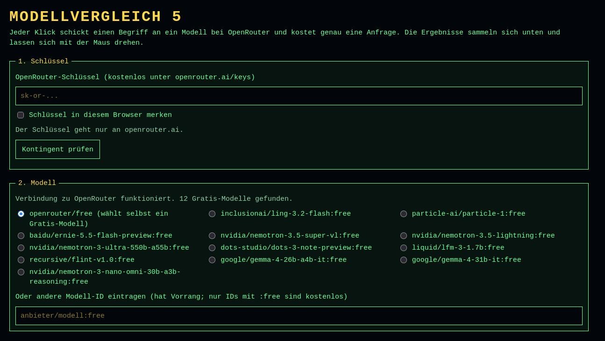
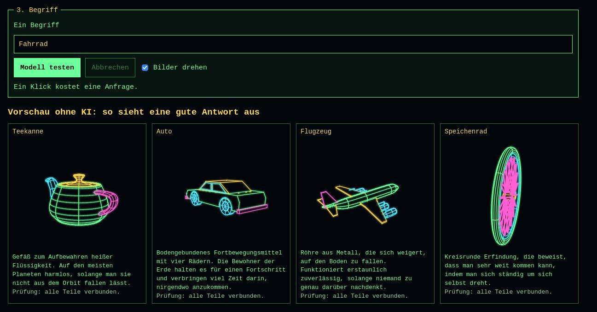

# Prompt_to_3D_modeltester

Der Prompt_to_3D-modeltester ist ein kleines Tool, mit dem man kleine 3D-modelle on the fly per KI-prompt generieren kann.


  Um herauszufinden, welche Modelle dafür wie gut geeignet sind ermöglicht mein Tool einen Vergleichstets verschiedener Modelle über openrouter.ai, wobei es so voreingestellt ist, dass erstmal nur die Free-Modelle verwendet werden.


Dokumentation zur Nutzung von KI bei OSEG. Das Repository sammelt nachvollziehbare Anleitungen und Konfigurationsbeispiele. Der erste praktische Einstieg ist **OpenCode 2 mit K2 Horizon über die IFM-API**.

## Einstieg

Es handelt sich dabei um eine html-datei mit integriertem javascript.   Diese kann man bei sich mit einem Webbrowser von der lokalen Festplatte aus starten.


## Anwendung


Zuerst wird die Verbindung zu openrouter.ai aufgebaut. Dazu muss man einen gültigen key eintragen den man vorher auf seinem account bei openrouter.ai generiert hat (kostet nix). Ausserdem kann man ein Model auswählen doer man belässt es bei der Default-Auswahl welche ausschliesslich Free-models verwendet.

   


[//]: #(<p><a href="https://raw.githubusercontent.com/AlexDorsten/oseg-ki-docs/tree/main/examples/prompt_to_3d-modeltester/images/remote_model.jpg" target="_blank"></a></p>)


Dann kann man einen Begriff eingeben und das Model generiert daraus ein einfaches 3D-objekt und speichert dieses im gleichen lokalen Ordner wo auch die html-datei liegt.

   


## Struktur

```text
README.md                      Überblick und Einstieg
LICENSE                        Vollständiger CC-BY-4.0-Lizenztext
src/                           enthält die html-datei mit dem tool
```

## Dokumentation pflegen

- Schreibe auf Deutsch und kennzeichne Meinungen, Vorschläge und beschlossene Entscheidungen eindeutig.
- Ergänze bei veränderlichen technischen Angaben eine Primärquelle und das Datum des Abgleichs.
- Prüfe bei Änderungen an der Konfiguration auch die zugehörige Anleitung.
- Speichere API-Schlüssel außerhalb des Repositorys. `.scratch/` ist für lokale Arbeitsnotizen vorgesehen und wird von Git ignoriert.

Änderungen lassen sich lokal mit `git status` und `git diff` prüfen und anschließend gezielt mit `git add` und `git commit` versionieren.

## Lizenz

Die Inhalte dieses Repositorys, einschließlich der Konfigurationsbeispiele, stehen unter **Creative Commons Namensnennung 4.0 International (CC BY 4.0)**, soweit nicht ausdrücklich anders gekennzeichnet.

Zur Namensnennung kann **„OSEG-AI-Mitwirkende“** verwendet werden. Verlinke bei einer Weitergabe die verwendete Originalfassung und die Lizenz; kennzeichne vorgenommene Änderungen. Ein möglicher Hinweis lautet:

> OSEG-AI-Mitwirkende, „OSEG-AI“, [CC BY 4.0](https://creativecommons.org/licenses/by/4.0/). Quelle: [oseg-ki-docs](https://github.com/AlexDorsten/oseg-ki-docs). Änderungen: Beschreibung der Änderungen.

Bei einer Weitergabe möglichst die verwendete Fassung verlinken und die Beschreibung der Änderungen anpassen. Der vollständige Lizenztext steht in [LICENSE](LICENSE); eine deutsche Erläuterung bietet [Creative Commons](https://creativecommons.org/licenses/by/4.0/deed.de). Verlinkte externe Projekte behalten ihre eigenen Lizenzen.


